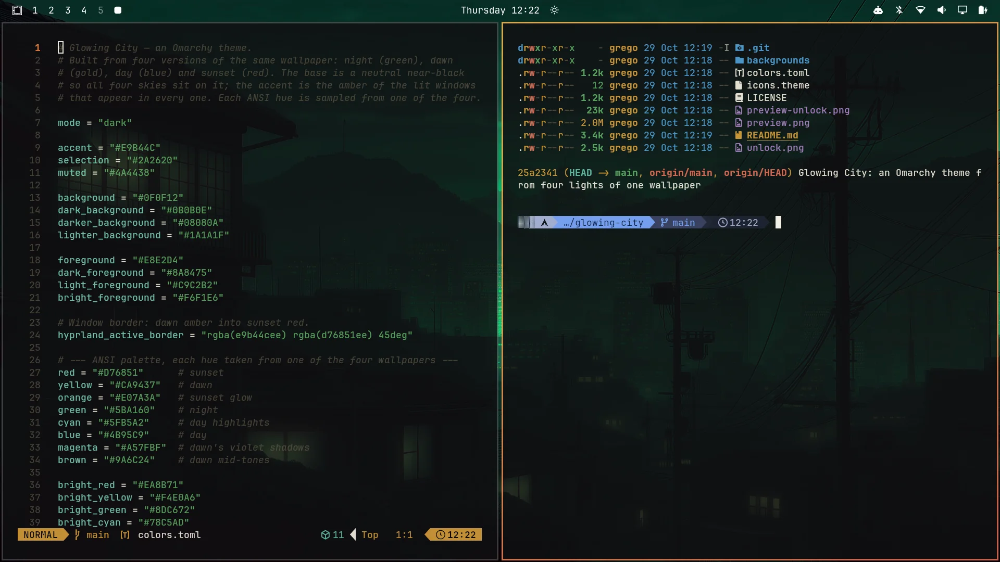

# Glowing City — an Omarchy theme

An [Omarchy](https://omarchy.org/) theme built around one wallpaper in
four lights: **night** (green), **dawn** (gold), **day** (blue) and
**sunset** (red). A neutral near-black base, warm lamplight text, and an
**amber accent** taken from the lit windows that glow in every one of them.



## The idea

The four wallpapers share everything except the sky: black rooftops and
power lines, a city in the haze, and lamp-lit windows. The theme is built
from what they share, so all four look at home on it:

- **Base:** a neutral near-black (`#0F0F12`). A green or red tint would
  clash with half the set.
- **Text:** warm lamplight off-white (`#E8E2D4`).
- **Accent:** window amber (`#E9B44C`), used for the bar, highlights and
  the unlock screen.
- **Window borders:** a gradient from dawn amber to sunset red.

## A terminal palette from the wallpapers

Every ANSI colour is sampled from one of the four images, so `eza`/`ls`,
`git`, syntax highlighting and TUIs look like part of the set:

| Colour  | From                  | Normal / bright        |
|---------|-----------------------|------------------------|
| green   | night                 | `#5BA160` / `#8DC672`  |
| blue    | day                   | `#4B95C9` / `#7FB4E0`  |
| cyan    | day's highlights      | `#5FB5A2` / `#78C5AD`  |
| red     | sunset                | `#D76851` / `#EA8B71`  |
| orange  | sunset glow           | `#E07A3A`              |
| yellow  | dawn                  | `#CA9437` / `#F4E0A6`  |
| magenta | dawn's violet shadows | `#A57FBF` / `#C7A6DB`  |
| brown   | dawn's mid-tones      | `#9A6C24`              |

Folder icons: `Yaru-yellow`.

## A day in four wallpapers

The backgrounds are numbered so cycling them runs through a day, starting
at night (the default when you switch to the theme):

1. `1-glowing-city-night.jpg` — the original green
2. `2-glowing-city-dawn.jpg` — honey-gold morning
3. `3-glowing-city-day.jpg` — blue haze
4. `4-glowing-city-sunset.jpg` — red evening

Cycle them with `Super+Ctrl+Space` or `omarchy theme bg next`.

## Wallpaper by time of day (optional)

The `time-of-day/` folder switches the wallpaper by itself, so the city
follows the real day:

| From  | Wallpaper |
|-------|-----------|
| 06:00 | Dawn      |
| 12:00 | Day       |
| 18:00 | Sunset    |
| 00:00 | Night     |

A systemd user timer runs at those four times, and two Omarchy hooks run
it when you switch to the theme and when you log in, so the right sky is
up at once. If the laptop was asleep or off at a switch time, the timer
catches up when it comes back. It does nothing while another theme is
active, and `Super+Ctrl+Space` still works: a hand-picked wallpaper stays
until the next switch time.

Set it up after installing the theme:

```bash
cd ~/.config/omarchy/themes/glowing-city/time-of-day
install -Dm755 glowing-city-time ~/.local/bin/glowing-city-time
install -Dm644 -t ~/.config/systemd/user glowing-city-time.service glowing-city-time.timer
omarchy hook install theme-set hook-glowing-city-time
omarchy hook install post-boot hook-glowing-city-time
systemctl --user daemon-reload
systemctl --user enable --now glowing-city-time.timer
glowing-city-time
```

To change the times, edit the hours in `~/.local/bin/glowing-city-time`
and the `OnCalendar` line in `~/.config/systemd/user/glowing-city-time.timer`,
then run `systemctl --user daemon-reload`.

To turn it off:

```bash
systemctl --user disable --now glowing-city-time.timer
```

## Install

```bash
omarchy theme install https://github.com/ggregoro/glowing-city
omarchy theme set "Glowing City"
```

Or clone it manually:

```bash
git clone https://github.com/ggregoro/glowing-city \
  ~/.config/omarchy/themes/glowing-city
omarchy theme set glowing-city
```

## Boot and login screen

The theme carries a matching unlock screen: Omarchy's pixel `OMARCHY`
logo in window amber on the theme's near-black, with lamplight text. It
styles both the boot splash and the login screen, and it is listed in
Omarchy's unlock screen picker. To apply it by hand:

```bash
omarchy plymouth set-by-theme glowing-city
```

It asks for your password and rebuilds the boot image, so give it a few
seconds. `omarchy plymouth reset` puts Omarchy's default back.

## Tweaking

Edit `colors.toml`, then re-run `omarchy theme set glowing-city`.
Everything else — terminal colours, Hyprland borders, the bar, btop,
Neovim — regenerates from it.

## Credits & licensing

The original green wallpaper comes from the Osaka Jade theme that ships
with Omarchy; the dawn, day and sunset versions are recolours of it. The
unlock logo is Omarchy's own, recoloured. Theme files (`colors.toml`,
`icons.theme`, this README) are MIT-licensed — see `LICENSE`.
